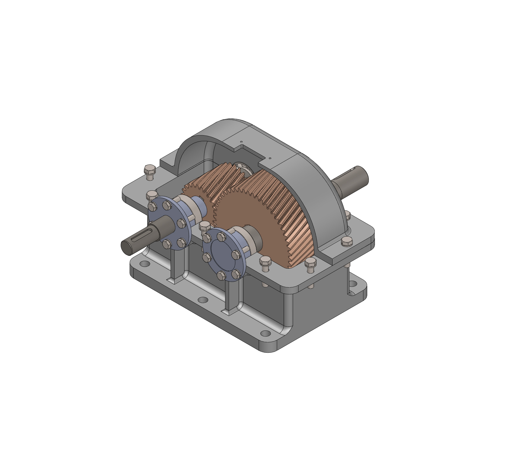

# Reduction Gearbox — SolidWorks CAD

A reduction gearbox CAD project modeled in SolidWorks, featuring a mechanical assembly with shafts, a helical gear component, housing, cover, bushings, closure caps, and fastening hardware.

The repository contains the native SolidWorks assembly and part files, allowing the model to be opened and its individual components inspected.

## Assembly Preview

## Project Overview

Reduction gearboxes transmit rotational power while reducing output speed and increasing available output torque, subject to mechanical losses.

This project focuses on the CAD representation of a gearbox and the arrangement of its mechanical components within a housing. It brings together individual part geometry, shaft positioning, enclosure details, and fastening components in an assembly.

## Main Components

- **Housing and cover** — Enclose the internal mechanism and provide the main structural geometry.
- **Shafts** — Represent the rotating members of the transmission.
- **Helical gear component** — Provides the gear geometry used in the assembly.
- **Bushings and closure caps** — Form supporting and enclosing details around the shaft locations.
- **Service components** — Include a gauge and oil drain screw.
- **Fastening hardware** — Includes bolts, screws, and spring lock washers.

## Opening the Model

1. Select **Code → Download ZIP** on the repository page.
2. Extract the entire ZIP archive into a local folder.
3. Open `Assembly.SLDASM` in a compatible version of SolidWorks.
4. Keep the supplied part files together so SolidWorks can locate the assembly references.

Download the full repository rather than only the assembly file, as SolidWorks assemblies reference separate part files.

If SolidWorks asks for a missing component, browse to the extracted folder and select the corresponding file. Individual `.SLDPRT` files can also be opened separately.

## Project Focus

- Mechanical component modeling
- Assembly organization in SolidWorks
- Gearbox packaging and component arrangement
- Housing and cover geometry
- Technical visualization of a mechanical assembly

This repository documents the CAD model. Gear-ratio calculations, load ratings, and analysis reports are not included.

